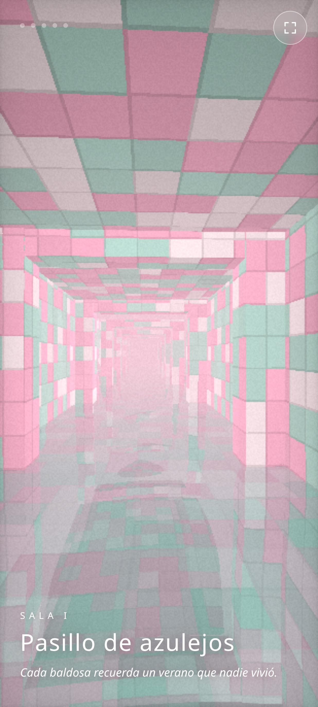

# POOLROOMS

Recorrido inmersivo por las poolrooms: pasillos de azulejos inundados, toboganes, un túnel con un ojo azul y una salida a la noche.

**Jugar:** https://jona-mhw.github.io/mh-poolrooms-game/

- Un solo HTML con WebGL puro, sin librerías ni conexión a internet.
- Hecho para celular en vertical: arrastra el dedo para mirar y toca para pasar a la sala siguiente. Tiene pantalla completa y sonido generativo.
- Construido por Claude Opus 5.5 con Fable 5.2 como advisor.

